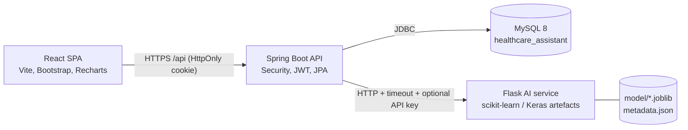
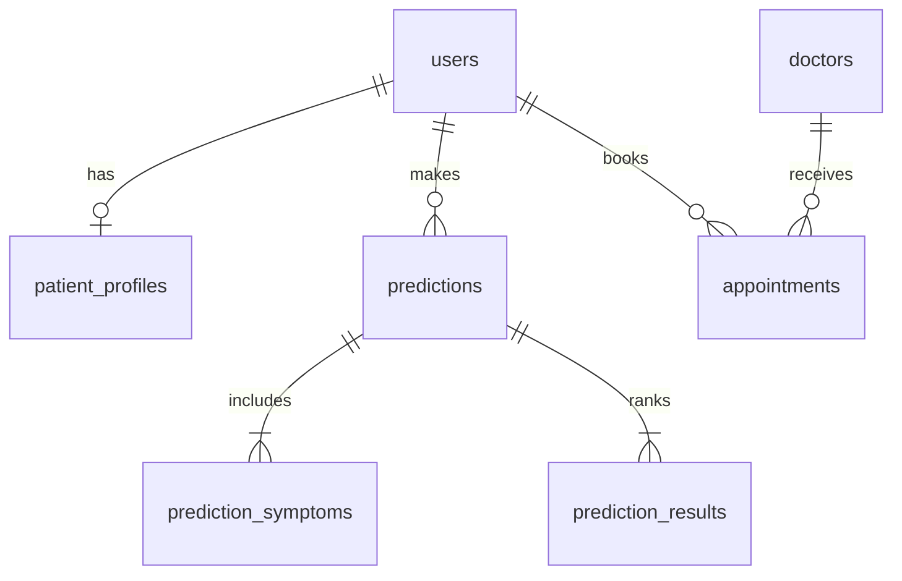

# Architecture

## Components and data flow

1. The browser only talks to Spring Boot. It never reaches Flask or MySQL.
2. **Login**: Spring verifies the BCrypt hash and sets a JWT in an **HttpOnly** cookie. JavaScript cannot read it.
3. **Prediction**: React `POST /api/predictions` → Spring validates the body and the user → calls Flask `POST /predict`
   (connect/read timeouts; failures become 503/502) → stores prediction, symptoms and ranked results in a transaction
   → returns the DTO. No DB transaction is open during the Flask call.
4. **History / detail**: queries include the patient id, so another patient's id is indistinguishable from a missing one (404).
5. **Appointments**: slots are generated from the doctor's weekdays/hours/slot length; unique DB indexes make double
   booking impossible even under concurrency.
6. **Admin**: `/api/admin/**` requires `ROLE_ADMIN` on the server. Analytics are aggregates with a minimum group size.

## Entity relationships

## ML pipeline (ai-service)

`train_model.py` (offline) → `model/` artefacts → `predict.py` (loaded once at Flask start-up).

* Data: 4,920 raw rows → **304 unique** after de-duplication (94 % of rows were exact duplicates).
  De-duplication happens **before** splitting; otherwise every test row also appears in training (the report shows
  100 % overlap with the naive split).
* Split: 60/20/20 stratified on unique records, fixed seed 42.
* Candidates: logistic regression, decision tree, random forest, linear SVM, Keras MLP.
* Selection: mean macro-F1 from 4-fold × 3-repeat CV on train+val; models within 0.01 are tied and the simplest wins.
  Test split is evaluated once, for the selected model only.
* Result: five models reach ≈100 % (decision tree ≈ 65 %). Logistic regression is selected. See
  `ai-service/reports/evaluation_report.md` for the full tables, robustness check and caveats.
* **Why no neural-network claim**: ~300 unique records do not justify a neural network. It is trained and reported for
  comparison only; it is not better than logistic regression.
* **No calibration**: too little data to fit and validate it, so scores are labelled `uncalibrated_model_score` everywhere.
* **Explainability**: occlusion sensitivity (drop in the top score when a symptom is removed). It shows what the model
  reacts to; it is not a medical explanation.

## Security design

| Concern | Control |
|---|---|
| Passwords | BCrypt (cost 12); 8–72 chars with letter + number; hash never serialised |
| Session | JWT (HS256) in HttpOnly cookie, `SameSite` configurable, `Secure` in production; expiry from `JWT_EXPIRATION_MINUTES`; user and **role re-read from DB on every request** |
| CSRF | SameSite + strict CORS + required `X-Requested-With` header for cookie-authenticated unsafe requests |
| Authorization | URL rules in `SecurityConfig` (`/api/admin/**` → ADMIN, patient APIs → PATIENT) + ownership in queries |
| Self-registration | always creates `PATIENT`; role cannot be supplied |
| Brute force / abuse | in-memory per-IP limits on login/register and predictions (use a gateway/Redis when scaling out) |
| Errors | uniform JSON; no stack traces or SQL; Flask errors are translated |
| Logging | no symptoms, passwords or tokens logged (Flask logs method/path/status only) |
| Internal service | Flask bound to localhost by default; optional shared `X-Internal-Api-Key`; not exposed publicly |
| SQL injection | JPA/JPQL parameter binding only; `LIKE` wildcards stripped from search |
| Analytics privacy | groups with fewer than `ANALYTICS_MIN_GROUP_SIZE` distinct patients are suppressed; no per-patient data in admin APIs |

**Token strategy and its risks.** The cookie approach avoids exposing the JWT to JavaScript (XSS cannot steal it) at
the cost of needing CSRF defences (above). The JWT is not revocable before expiry except by deleting the user;
keep the lifetime short. Bearer tokens in the `Authorization` header are also accepted (for Postman/tests) and are not
CSRF-prone, but must never be stored in `localStorage` by a browser client.

**Privacy / compliance.** This project does **not** claim HIPAA, GDPR or any other compliance. Symptom lists linked to an
account are health data. Before a real deployment obtain a legal and technical assessment (lawful basis/consent,
retention and deletion, breach notification, data-processing agreements with the host, encryption at rest, backups).
Data minimisation here: name, e-mail, optional phone/date of birth/gender, symptoms and results; no addresses and no
free-text medical history. No deletion/export endpoint is implemented yet (see limitations).
